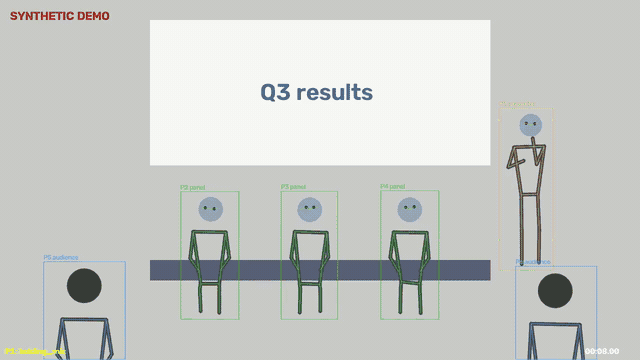
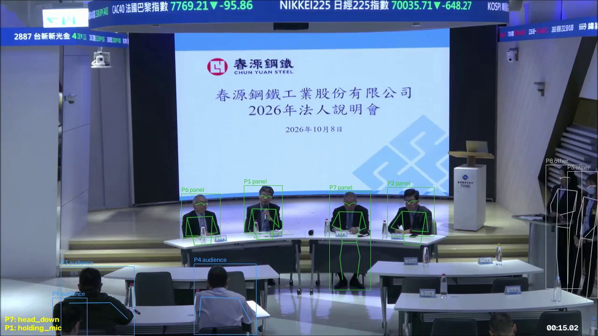

# Gesture Pipeline

[](https://github.com/OWNER/REPO/actions/workflows/tests.yml)

Counts gestures in recorded videos (hand raises, nods, head shakes, gesturing,
looking down, holding a microphone, standing up) for every person on screen, works
out who is the **presenter**, the **panel** and the **audience**, and exports
everything to Excel. Built for Taiwan Stock Exchange investor-conference recordings
(法人說明會); works on any video with a fixed camera: lectures, meetings, your own recordings.

Runs locally on an ordinary computer. No cloud, no account, and no video ever leaves the machine.



*The built-in demo (`gestures demo`): a scripted conference where every gesture happens at a
known time. Boxes show each person's id and role; detected gestures appear bottom-left.*



*A real TWSE recording (春源鋼鐵 investor conference, 2026-10-08, from the TWSE WebPro portal),
shown for illustration. Four panelists (green), audience seen from behind (blue), staff at the side
(grey). The panelist answering is detected `holding_mic`; another is detected `head_down`.*

## What you get

For each video, and combined across all videos in `outputs/results.xlsx`:

| person_id | role | gesture | count | total_duration_s | rate_per_min | share_of_time |
|---:|:---|:---|---:|---:|---:|---:|
| 1 | presenter | holding_mic | 1 | 16.0 | 3.0 | 0.80 |
| 1 | presenter | gesturing | 1 | 4.0 | 3.0 | 0.20 |
| 2 | panel | nod | 2 | 2.37 | 3.0 | 0.06 |
| 3 | panel | head_shake | 1 | 1.25 | 1.5 | 0.03 |
| 5 | audience | hand_raise | 1 | 3.0 | 1.5 | 0.08 |

*(Rows from the demo's Summary sheet.)* The workbook also has every single event with start and
end time and confidence, a per-role breakdown, the presentation/Q&A split, everyone detected with
the reason for their role, and a record of the filters used. Each video also gets a
**debug video** like the images above, so every number can be checked by eye.

## Try it in 5 minutes (no video needed)

You need **Python 3.10–3.13** and **FFmpeg**.

```bash
# macOS (Homebrew). On Ubuntu: sudo apt install ffmpeg python3-venv
brew install ffmpeg python@3.12

git clone https://github.com/OWNER/REPO.git gestures
cd gestures
python3.12 -m venv .venv
source .venv/bin/activate          # Windows: .venv\Scripts\activate
pip install -e ".[dev]"

gestures doctor                    # checks everything is installed
python -m pytest                   # 54 automated checks, should end with "passed"
gestures demo --open               # runs a synthetic conference, opens the video + Excel
```

The demo prints a table of scripted vs. detected gestures and ends with
`Demo PASSED`. Results land in `outputs_demo/`.

**Don't want to install anything?** Open the latest run under the repository's **Actions** tab. Every
push runs all tests and the demo, and the demo's debug video and Excel file can be downloaded
from **Artifacts** at the bottom of the run page.

## Use it on real videos

```bash
gestures run path/to/video.mp4 --debug-video        # one video
gestures run data/raw/                              # a whole folder (resumes if interrupted)
gestures run data/raw/ --end 120                    # quick test: first 2 minutes of each
gestures export                                     # rebuild outputs/results.xlsx
gestures export --roles panel --phase qa --min-confidence 0.6 --xlsx outputs/panel_qa.xlsx
```

The first run downloads the person-detection model (~8 MB). TWSE recordings can be downloaded with
`python scripts/download_webpro.py --list data/webpro_links.txt` (needs `yt-dlp`), see
[docs/data_sources.md](docs/data_sources.md).

**Speed:** on an M4 Pro MacBook, about 6× faster than real time (a 36-minute conference in ~7
minutes). On a computer without a graphics chip, expect roughly half real time.

## How it works

```
video → frames (8/s) → people found, tracked and given 17 body points (YOLO26-pose)
      → people cleaned up and given roles → gesture rules on the body points → Excel
```

1. **People.** Every person is detected and tracked so they keep one id. 17 body points
   (nose, eyes, shoulders, elbows, wrists, hips, knees, ankles) are stored for each. This is
   the only slow step and runs once per video.
2. **Roles.** From how each person appears: seen from behind → audience; seated in a row facing
   the camera → panel; standing or alone facing the camera → presenter; at the side → staff;
   pictures of people on the slides are ignored. The reason is written next to every role.
3. **Gestures.** Explicit, documented rules on the body points, scaled to each person's size.
   Example: *hand raise = a wrist above the top of the head, elbow lifted, for at least 1 second*.
4. **Results.** Counts, durations, rates per minute and every individual event, filterable by
   role, gesture, confidence and part of the video.

Everything is explained in plain language in [docs/](docs/README.md): how roles are decided,
the exact rule for every gesture, filtering, all settings, and how accuracy is checked.

## Using it on other kinds of video

Rename roles (e.g. `teacher` / `student`), fix roles for a known room, or ignore areas such as a
TV screen, all in `config.yaml`. See [docs/custom_videos.md](docs/custom_videos.md). Works best
with a fixed camera, 720p or better, and people at least ~80 px tall.

## Limitations

* Faces in wide conference shots are ~25 px wide: head movement is measurable, facial
  expressions and gaze are not.
* People far back in a wide shot may not be detected; audience results describe the front rows.
* For people seen from behind, small hand movements near the head are deliberately not counted
  (the model has to guess hidden hands).
* A person who changes place (e.g. presenter → panel table) is counted as two people.
* Accuracy so far has been checked by eye on clips from six videos; a formal comparison against
  hand-coded clips is planned ([docs/validation.md](docs/validation.md)).

## Project layout

```
gesture_pipeline/   the program (cli, ingest, frames, extractors, people, gestures, export, demo)
tests/              automated tests, including a synthetic end-to-end run
scripts/            TWSE WebPro downloader
docs/               documentation and README images
config.yaml         all settings
data/raw/           your input videos (not in git)
outputs/            results, one folder per video (not in git)
```

## Status

| Part | State |
|---|---|
| Video download, frame sampling, resumable batch runs | done |
| Person detection, tracking, body keypoints (YOLO26-pose) | done |
| Roles: presenter / panel / audience / staff / pictures on slides | done, correct on 12 clips from 6 TWSE videos |
| 9 gestures, presentation/Q&A split, filtered Excel export, debug videos | done, calibrated on the same clips |
| Demo + automatic tests on GitHub | done |
| Talk time per person (speech detection + microphone cue) | planned |
| Formal accuracy check against hand-coded clips | planned |

## Data and privacy

Videos and results are excluded from git (`.gitignore`). TWSE recordings belong to their
publishers; check their terms before redistributing footage or results that identify people.
